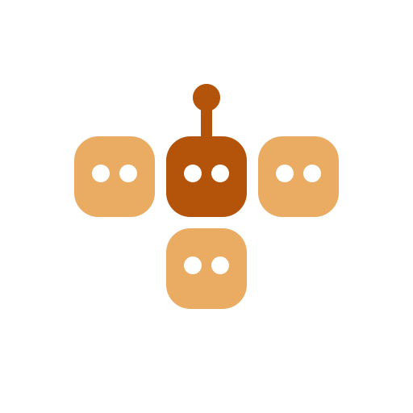

  <picture>
    <source media="(prefers-color-scheme: dark)" srcset="tessaly-logo-dark.svg">
    
  </picture>

<h1 align="center">Tessaly</h1>

Run many coding agents in parallel, on your own machine.

Tessaly is an open source, local-first tool for running coding agents side by side. Each agent gets its own git worktree, so they never step on each other. You review the diffs, open the pull requests and keep everything on hardware you control.

- Works with Claude Code, Codex, any CLI agent, and agents that speak ACP
- Kanban board to see what each agent is doing and what needs you
- Diff review and pull requests on GitHub, GitLab and Bitbucket
- Issue import from GitHub, GitLab, Linear, Jira and Bitbucket
- Previews of running apps through one port
- Private local memory, stored as Markdown on your machine
- Self-hosted: one Go binary with a browser UI, reachable from your phone over your own SSH tunnel, VPN or reverse proxy

Security comes first. Tessaly binds to localhost by default, requires login, and never sends your code or memory to a cloud service of its own.

## Repositories

| Repository | What it is |
| --- | --- |
| [tessaly](https://github.com/tessaly-dev/tessaly) | The daemon, CLI (`tess`) and web UI. Coming soon. |
| [.github](https://github.com/tessaly-dev/.github) | This profile and the default community files for the org. |

## Get involved

- Read the [contributing guide](https://github.com/tessaly-dev/.github/blob/main/CONTRIBUTING.md) before your first pull request.
- Report security issues privately to security@tessaly.dev. See the [security policy](https://github.com/tessaly-dev/.github/blob/main/SECURITY.md).
- Everything else: hello@tessaly.dev or [tessaly.dev](https://tessaly.dev).

Tessaly is licensed under Apache-2.0 and maintained by 86-88 Solutions.
